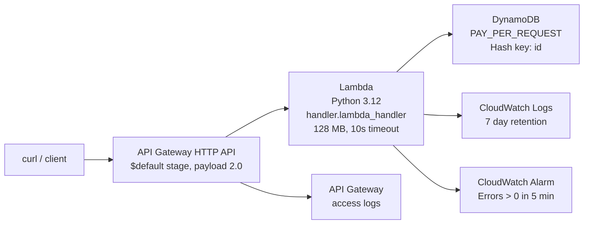

# Architecture — Serverless Items API

## Diagram

Text version, for readers without Mermaid rendering:

1. A client sends an HTTP request to the API Gateway HTTP API endpoint.
2. API Gateway routes it (`POST /items`, `GET /items`, `GET /items/{id}`, `DELETE /items/{id}`) to the Lambda function through a proxy integration.
3. Lambda validates the request, reads/writes DynamoDB, and returns a JSON response. API Gateway returns that response to the client.
4. Lambda logs go to CloudWatch Logs. A CloudWatch alarm watches the Lambda `Errors` metric.

## Components

- **API Gateway HTTP API:** cheaper and simpler than a REST API, with enough routing for this lab. Payload format 2.0, so the handler reads `requestContext.http.method` and `requestContext.http.path`. No authentication in this lab on purpose; a real API would add IAM auth, a JWT authorizer, or API keys, and that would be called out in the README.
- **Lambda:** one function, one handler, standard library plus `boto3` (included in the runtime). Environment variable `TABLE_NAME` is set by Terraform. No secrets in code or environment variables.
- **DynamoDB:** one table, `PAY_PER_REQUEST`, hash key `id` (string). Items store `id`, `name`, `description`, and `created_at`. No sort key, no GSI in this version.
- **IAM:** the Lambda execution role allows only `logs:CreateLogGroup`, `logs:CreateLogStream`, `logs:PutLogEvents` on its own log group, and `dynamodb:GetItem`, `PutItem`, `DeleteItem`, `Scan` on this table only. API Gateway is allowed to invoke this function only, scoped to this API (`source_arn`).
- **Observability:** Lambda log group and API Gateway access log group, both with 7 day retention, plus a Lambda Errors alarm. No SNS action in this lab.

## Trade-offs (deliberate, for a first lab project)

- **HTTP API vs REST API:** HTTP API is simpler and cheaper, but has fewer built-in features (for example, no usage plans or request validation in the same way). For a small CRUD lab, that trade is worth it. REST API would be the better interview story if the role specifically asks for it.
- **`Scan` for `GET /items`:** acceptable for a tiny lab table, and easy to explain. It does not scale: at real volume it reads the whole table. The production replacement would be a `Query` against a GSI, pagination with `LastEvaluatedKey`, and a limit. That limit is noted here so the choice reads as deliberate, not unaware.
- **Flat Terraform files vs modules:** this project uses one file per concern (`dynamodb.tf`, `iam.tf`, `lambda.tf`, `apigateway.tf`) rather than reusable modules. That keeps Project 1 readable in a weekend. Reusable modules, environments, and remote state are the point of Project 2.
- **Local Terraform state:** acceptable for a solo lab with one deployer, and it keeps weekend setup simple. It is not acceptable for a team or for production: state would live in an S3 backend with DynamoDB locking, which Project 2 builds.
- **No auth, no pagination, no update endpoint:** kept out to keep the project small and working. Each is a natural, honest follow-up, not a hidden gap.
